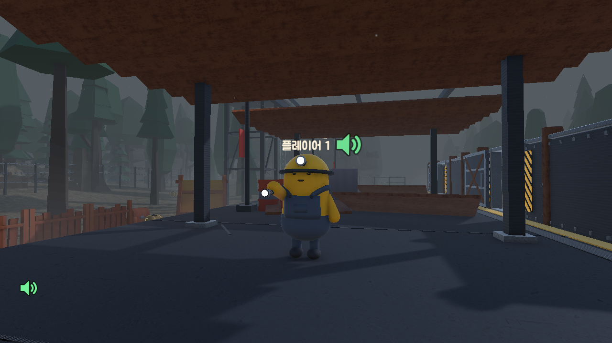
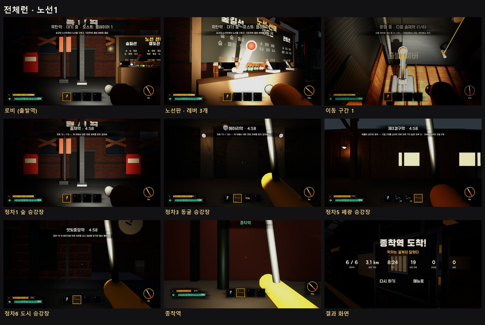
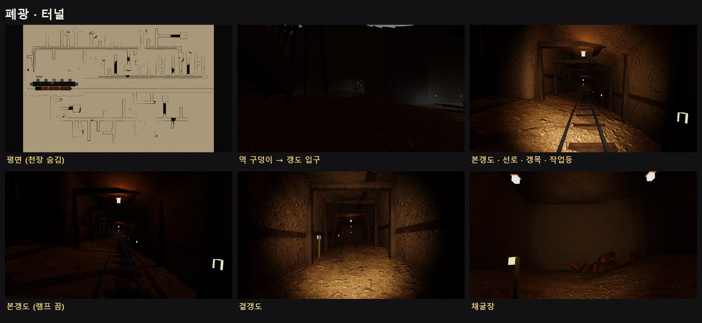
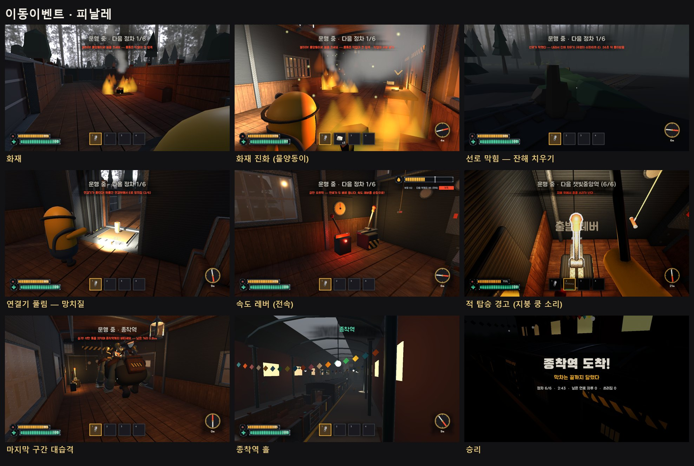
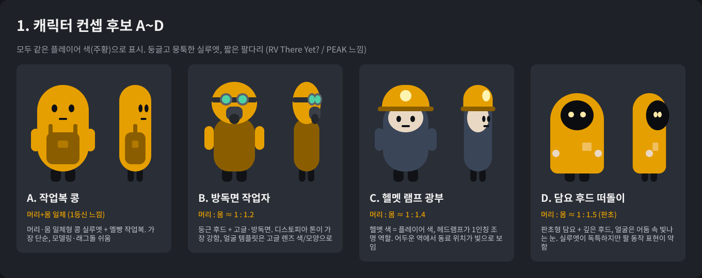
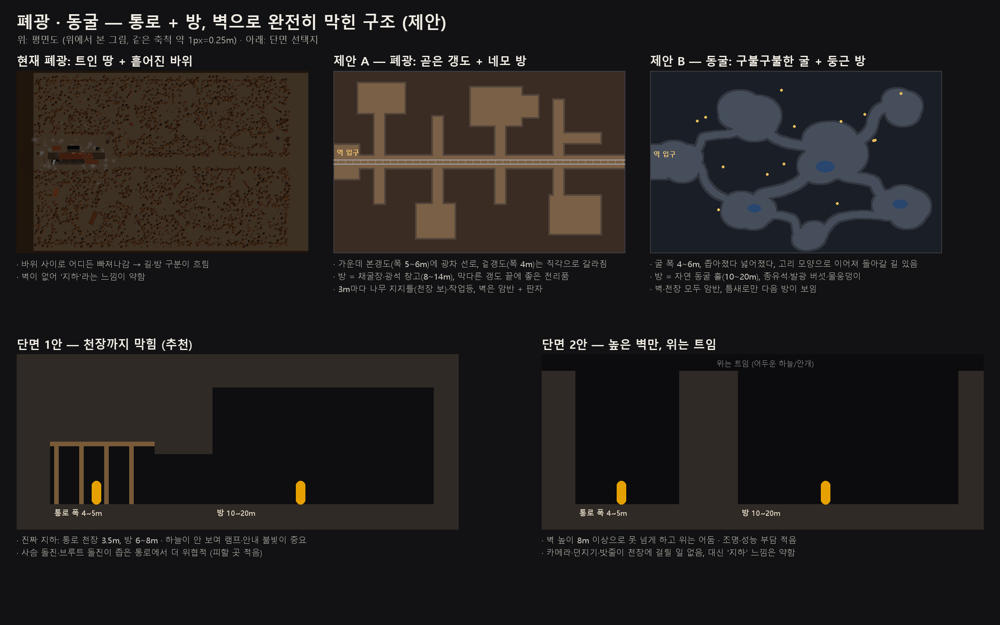
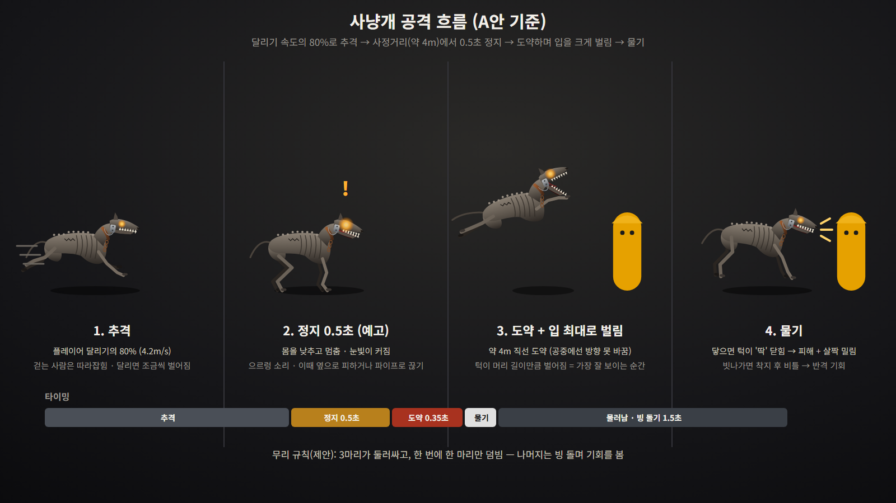

Blender MCP + Unity CLI + Notion MCP + Figma MCP + (추후 추가)FreeSound MCP

- Blender : 3D 오브젝트 디자인 및 생성, 애니메이션 적용
- Unity CLI : 유니티 3D 작업
- Notion : 기획 서류 검토 및 제안서 검수 통로. 이미지 전달경로 .(에이전트의 기획은 기본적으로 로컬 문서로 작성하고 사용자에게 보여 줄 기획 서류나 보고서, 제안서를 Notion으로 공유. 온라인과 다양한 플랫폼으로 쉽게 확인하고 수정할 수 있다.)
- Figma : 디자인 시트 제작, UI 작업을 진행함. 2D로 레퍼런스 작업 진행.

---

## 하게 된 이유
Claude Opus 5.5가 등장함과 동시에 어디까지 작업할 수 있을지 궁금해서 진행하게 된 단기 프로젝트.
다양한 MCP를 활용하여 가능한 모든 작업이 AI가 가능한 환경을 구성해보는것도 목적이 됨.

~~Codex Astra로 넘어가려고 CLaude 구독을 해지하고 이틀 뒤 만료일을 기다렸지만 Opus5.5가 나옴에 따라 넘어가지 않게 되었다. Claude 타이밍 좋네.~~
## 게임 기획

멀티플레이 게임, 디스토피아 테마에 거대 기차에서 각 종착역마다 연료를 수집해 최종역에 도달하는 게임. 

에이전트 툴 연결, 환경 구성, 기획 제안서 검토, 질문 답변만을 사용자(나)가 진행.

에이전트가 모든 에셋을 생성하고, 코드를 구성하도록 함. git을 관리하고, 게임을 빌드까지 진행하고 스크린샷과 게임 영상을 통해 사용자(나)와 개발 진행을 공유하며 진행한다.
## 디자인

Figma 및 Blender를 통해 에이전트가 작업한 디자인, 사용자와의 소통용 콘셉트 디자인

## 얻은 경험
다양한 MCP를 한번에 활용시켜 작업한 프로젝트는 이번이 처음이다. 전체를 AI가 직접 접근하고 제작 할 수 있도록 해보았다.
결론적으로 사용자 없이 리소스 생산과 게임 제작을 자율적으로 지속할 수 있었다.
직접 이러한 결과물을 얻어보고자 노력하는 경험을 얻을 수 있었습니다.
에이전트의 툴/MCP의 활용에 대해 더 나아갔음을 느낄 수 있었습니다.

Notion으로 적 형태를 제안하고, Figma로 초안을 2d로 만들게 하여 형태를 사용자에게 검토시키도록 하고, 컨펌받은 디자인 시트를 에이전트가 Blender로 3d 작업을 하여 완성시킴.

더 다양한 툴이 필요함을 느꼈고, 이를 찾아보며 툴의 중요성을 한단계 더 안 기분을 느꼈음.

좀 더 다양한 프로젝트를 도전해 보는것이 중요하다고 생각함.

다만 너무 성급한 시작은 빠른 포기를 야기함.
## 발생한 문제
- claude max x5로는 5시간 한계가 3회 발생했음.
## 향후 과제
- 사운드(bgm, sfx)를 작업하는 MCP나 tool 찾고 적용하기 <- 완료
- 이미지 생성 MCP 또는 ChatGPT를 연결하는 방법을 고안해보기.
- 에이전트에게 애니메이션을 잘 접근시킬 방법을 고안하기 (다른 MCP 또는 스크립팅 방식)
- 세부적인 요소에 대해 지속적으로 개선을 요청해야 해서 스트레스가 있었음.
